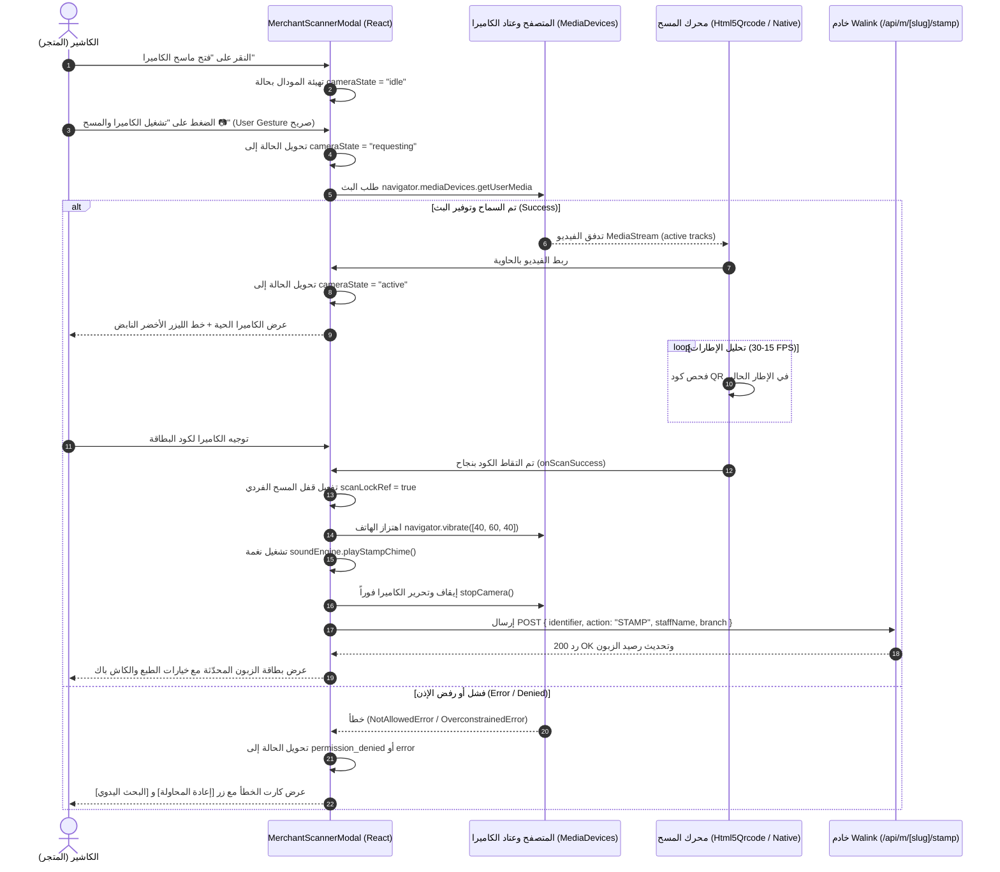
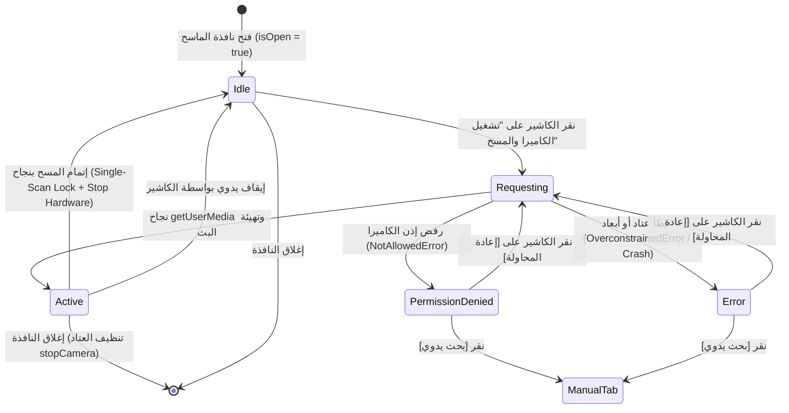

# 📷 خريطة وتشخيص نظام ماسح الكاميرا للكاشير (Walink Cashier PWA Scanner)
> **وثيقة تقنية معمارية وتشخيصية شاملة**  
> **المشروع:** Walink (نظام ولاء رقمي وكروت Apple / Google Wallet للشركات والمحلات)  
> **الهدف:** توثيق المسار الكامل لتشغيل الكاميرا ومسح بطاقات الزبائن، تفصيل المشكلة الحالية بدقة، وتقديم البدائل والحلول الهندسية لمناقشتها مع النماذج الأخرى أو الفريق البرمجي.

---

## 1. ملخص المشكلة الحالية (Current Problem Statement)

### الأعراض الظاهرة (Symptoms)
- عند فتح لوحة تحكم التاجر (`/m/[slug]`) على الهاتف وإضافتها للشاشة الرئيسية (**iOS PWA Standalone / WebClip** أو **Android PWA**):
- يضغط الكاشير على زر **"فتح ماسح الكاميرا (QR)"**.
- تظهر نافذة الماسح في حالة الاستعداد (`idle`).
- عند الضغط على زر **"تشغيل الكاميرا والمسح 📷"**، تتحول الحالة مؤقتاً إلى طلب الكاميرا (`requesting`)، ثم تفشل فوراً وتتحول إلى شاشة الخطأ (`error` state):
  > **العنوان:** "تعذر تشغيل الكاميرا"  
  > **النص التوضيحي:** "تعذر تشغيل الكاميرا"  
  > **الأزرار:** `[ 🔄 إعادة المحاولة ]` و `[ 🔍 بحث يدوي ]`.

### الأسباب الجذرية المكتشفة من فحص الكود (Root Cause Analysis)

1. **إخفاء الخطأ الحقيقي بسبب طبيعة مكتبة `html5-qrcode`:**
   - مكتبة `html5-qrcode` ترفض الوعود (Reject Promises) باستخدام **سلاسل نصية خام (`string`)** وليس كائنات استثناء `Error` رسمية (مثل: `"Unable to query supported devices."` أو `"Error getting userMedia, error = OverconstrainedError"`).
   - في كود الفحص:
     ```typescript
     setCameraErrorMessage(err instanceof Error ? err.message : "تعذر تشغيل الكاميرا");
     ```
     بما أن `err instanceof Error` تُرجع `false` للسلاسل النصية، يتم استبدال رسالة الخطأ الحقيقية بالرسالة الافتراضية العامة `"تعذر تشغيل الكاميرا"`، مما يحجب سبب الفشل التقني الفعلي عن الواجهة وسجلات المطور.

2. **تعارض قيود العدسات المتعددة على أجهزة iPhone (`OverconstrainedError`):**
   - أجهزة iPhone الحديثة (12 Pro, 13 Pro, 14 Pro, 15, 16) تحتوي على 2 إلى 3 كاميرات خلفية (Main, Ultra-wide, Telephoto).
   - إرسال قيد `{ facingMode: { ideal: "environment" } }` داخل Safari PWA قد يرمي `OverconstrainedError` إذا لم يتمكن WebKit من تحديد العدسة الافتراضية تلقائياً.

3. **حلقة التعليق داخل الـ Fallback في `html5-qrcode`:**
   - عند فشل الاستدعاء الأول، ينفّذ الكود الحالي محاولة بديلة:
     ```typescript
     const cameras = await Html5Qrcode.getCameras().catch(() => []);
     ```
   - داخل مكتبة `html5-qrcode` (`retriever.js` السطر 83)، تقوم دالة `getCameras()` بطلب بث تجريبي عبر:
     ```javascript
     mediaStream = await navigator.mediaDevices.getUserMedia({ audio: false, video: true });
     devices = await navigator.mediaDevices.enumerateDevices();
     closeActiveStreams(mediaStream); // إيقاف البث فوراً
     ```
   - على نظام iOS Safari PWA، إيقاف مسارات البث ثم طلب بث جديد فوراً في نفس الثانية يؤدي إلى **قفل العتاد (Hardware Camera Lock)** أو رفض WebKit بـ `NotReadableError` أو `AbortError`!

4. **تجاوز صلاحيات الـ WebClip / Standalone على iOS:**
   - تطبيقات الـ PWA على iOS المنشأة عبر "Add to Home Screen" تعمل داخل بيئة WebClip معزولة عن متصفح Safari العادي.
   - إذا تم رفض الصلاحية لمرة واحدة داخل الـ PWA، فإن Safari لا يظهر نافذة السؤال مجدداً إلا بإعادة ضبط المتصفح أو إعطاء الإذن الصريح، بينما المكتبة تستمر في محاولة التهيئة فترمي خطأ.

---

## 2. خريطة مسار تشغيل الكاميرا والمسح (Full Architecture & Execution Map)

### أ. الهيكل البرمجي والملفات المعنية
```text
src/
├── app/
│   ├── m/[slug]/page.tsx            # صفحة التاجر على السيرفر (SSR) واسترداد البيانات
│   └── api/m/[slug]/stamp/route.ts  # معالج API لعمليات الطبع، الكاش باك، ومنع الاحتيال
├── components/
│   ├── MerchantDashboardClient.tsx  # لوحة تحكم التاجر وتدبير النوافذ والمقاييس
│   └── MerchantScannerModal.tsx      # نافذة الكاميرا والماسح، والاتصال مع العتاد
└── lib/
    ├── sound.ts                     # محرك النغمات الصوتية عند المسح الناجح
    └── i18n/translations.ts         # قواميس اللغات الثلاث (العربية، الفرنسية، الإسبانية)
```

### ب. مخطط التدفق الكامل (Mermaid Sequence Diagram)



---

## 3. آلة الحالات لكاميرا الكاشير (Camera State Machine)

تتحكم النافذة في 5 حالات محكمة تضمن عدم حدوث أخطاء هيدريشن (Hydration) أو تسريب للذاكرة:



---

## 4. تنسيقات الأكواد المدعومة في المسح (Supported QR Code Formats)

يقبل المعالج المركزي `handleScannedCode` ثلاث صيغ رئيسية للرموز:

1. **الروابط الكاملة (Full Pass URLs):**
   - مثل: `https://walink.ma/pass/pass-atlas-4821`
   - يتم استخراج السيريال عبر التعبير النمطي: `/\/pass\/([a-zA-Z0-9_-]+)/`.
2. **بروتوكول Walink المباشر (Walink Deep Payloads):**
   - مثل: `WALINK:pass-atlas-4821:1718900000` أو `WALINK:4821`.
   - يتم تجريد البادئة وقراءة المعرّف مباشرة.
3. **الرمز الرقمي أو رقم الهاتف (Member Code / Phone):**
   - مثل: `#9506` أو `0661234567`.
   - يتم مطابقته أولاً في الكاش المحلي للمحل، أو إرساله إلى `/api/m/[slug]/stamp` لمطابقته في قاعدة بيانات Prisma.

---

## 5. مقارنة الحلول المقترحة للنقاش (Proposed Solutions Matrix)

| المعيار | الخيار 1: Native `<video>` + `jsQR` / `BarcodeDetector` (الموصى به) | الخيار 2: `@zxing/browser` | الخيار 3: إصلاح مكتبة `html5-qrcode` الحالية |
| :--- | :--- | :--- | :--- |
| **التوافق مع iOS PWA** | ⭐⭐⭐⭐⭐ ممتاز جداً (تحكم كامل بـ `<video playsinline>`) | ⭐⭐⭐⭐ جيد جداً | ⭐⭐ متوسط (أخطاء غير متوقعة في الـ WebClip) |
| **الأداء واستهلاك البطارية** | ⭐⭐⭐⭐⭐ يستخدم محرك C++ في أندرويد و Canvas خفيف في iOS | ⭐⭐⭐ جيد | ⭐⭐ تستهلك موارد عالية بسبب تكرار الفحص |
| **حجم الحزمة (Bundle Size)** | 🟢 خفيف جداً (~30KB) أو صفر عند استخدام `BarcodeDetector` | 🟡 متوسط (~120KB) | 🔴 كبير ومشتمل على ملفات مكررة |
| **إدارة أخطاء العتاد** | 🟢 شفافية تامة مع كائنات `Error` الحقيقية | 🟢 استثناءات واضحة | 🔴 وعود مرفوضة بسلاسل نصية مبهمة |
| **التحكم بالواجهة وتراكب العناصر** | 🟢 سيطرة كاملة على عنصر الفيديو بدون DOM Injection | 🟢 سيطرة جيدة | 🔴 المكتبة تُنشئ وتعدل عناصر DOM داخلية |

---

## 6. الكود المقترح للحل الجذري (Native HTML5 Video + Universal QR Engine)

بدلاً من الاعتماد على مكتبة تقوم بالتلاعب في الـ DOM، يتم استخدام عنصر `<video>` مباشر مع `navigator.mediaDevices.getUserMedia` الصريح:

```tsx
// 1. عنصر الفيديو النقي المتوافق 100% مع iOS WebKit و Android
<video
  ref={videoRef}
  autoPlay
  playsInline
  muted
  className="w-full h-full object-cover rounded-2xl"
/>

// 2. طلب الكاميرا الآمن المتوافق مع كافة العدسات
const constraints: MediaStreamConstraints = {
  audio: false,
  video: {
    facingMode: { ideal: "environment" },
    width: { ideal: 1280 },
    height: { ideal: 720 },
  },
};

const stream = await navigator.mediaDevices.getUserMedia(constraints);
if (videoRef.current) {
  videoRef.current.srcObject = stream;
  await videoRef.current.play();
}

// 3. محرك المسح الهجين السريع (Native BarcodeDetector -> Fallback to jsQR)
const scanFrame = () => {
  if (!scanningActive) return;
  
  if ("BarcodeDetector" in window) {
    const detector = new (window as any).BarcodeDetector({ formats: ["qr_code"] });
    detector.detect(videoRef.current)
      .then((barcodes: any[]) => {
        if (barcodes.length > 0) handleSuccess(barcodes[0].rawValue);
        else requestAnimationFrame(scanFrame);
      })
      .catch(() => requestAnimationFrame(scanFrame));
  } else {
    // رسم الإطار على canvas مصغر وتحليله بـ jsQR بسرعة فائقة
  }
};
```

---

## 7. أسئلة للنقاش والتفكير المشترك (Discussion Questions for Peers/Models)

1. **إدارة صلاحيات الكاميرا في iOS Standalone WebClip:**
   هل من الأفضل إظهار فحص استباقي عبر `navigator.permissions.query({ name: "camera" as any })` قبل محاولة فتح الكاميرا، أم الاعتماد المباشر على زر النقر اليدوي مع معالجة استثناء `NotAllowedError`؟
2. **تخفيف مشكلة تعدد العدسات (Multi-lens on iPhone Pro):**
   هل نحدد `facingMode: "environment"` كسلسلة نصية بسيطة بدون `{ ideal: ... }` لتجنب خطأ `OverconstrainedError` الشائع في سفاري؟
3. **المكتبة الأنسب:**
   هل تفضل الاعتماد على عنصر فيديو نقي `<video playsInline>` مع `jsQR` (أو محرك مسح مباشر) والتخلص نهائياً من الاعتماد على `html5-qrcode`؟
